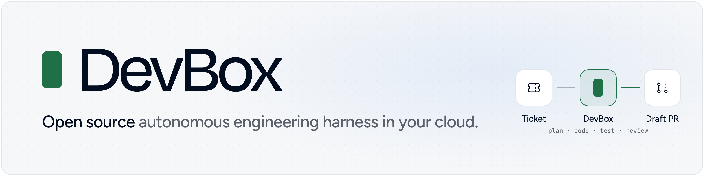
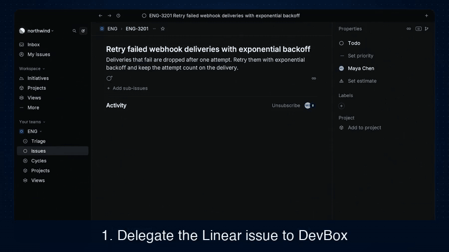
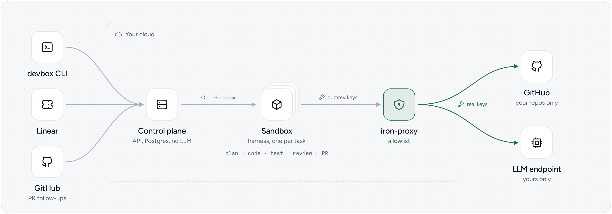
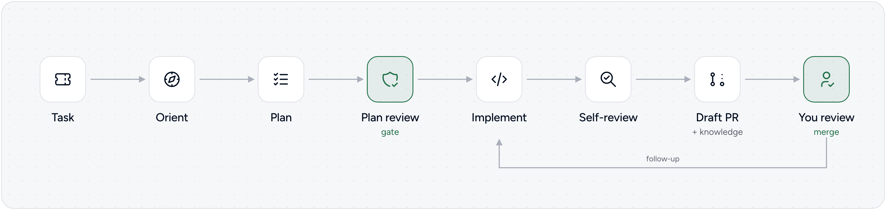
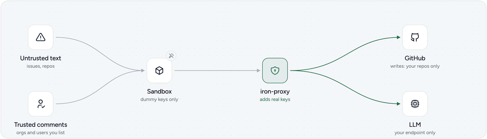

<picture>
  <source media="(prefers-color-scheme: dark)" srcset="docs/images/banner-dark.png">
  
</picture>

<p align="center">
  <a href="LICENSE"></a>
</p>

Hand DevBox a ticket. It plans the change, writes the code, runs the tests,
reviews its own work and opens a draft pull request. You review and merge.
Comment on the pull request, and it pushes the fix to the same branch.

<p align="center">
  <a href="https://youtu.be/F5RIdaJRal8"></a>
  <br>
  <a href="https://youtu.be/wJQK3yCfYoI">Watch the full launch video (2 min)</a>
</p>

DevBox runs on your infrastructure, with your model keys. It is built for a
whole engineering org: one shared harness that picks up Linear tickets,
answers on GitHub pull requests, works across your repos, and remembers what
it learned in them.

## Why we built it

We are RudderStack, a customer data infrastructure company. Since April our
engineers have handed tickets to DevBox. Today it merges about **35% of our
internal pull requests**, with about an **80% merge rate**.
[Read the story behind it](https://www.rudderstack.com/blog/open-sourcing-devbox/).

Coding tools like Claude Code and Codex make one developer faster. We wanted the
other half: a shared teammate the whole org can delegate to, that runs where our
code and secrets already live, and that gets better at our repos over time.
DevBox works alongside those tools.

## Features

- **Staged, gated pipeline.** Orientation, planning, plan review, implementation, self-review. No code is written until the plan passes review.
- **Closed feedback loop.** Review comments, @mentions and failed CI runs route back to the running task (with the GitHub App).
- **Versioned memory.** Learnings are distilled into your repo and land as a commit on the pull request, reviewed like code.
- **Credential isolation.** Sandboxes hold placeholder tokens. An egress proxy injects the real ones and scopes writes to your repos.
- **Per-stage model routing.** OpenAI or Anthropic, with model and reasoning effort set per stage.
- **Self-hosted.** Docker Compose or Kubernetes, one isolated sandbox per task.

## How it works

<picture>
  <source media="(prefers-color-scheme: dark)" srcset="docs/images/architecture-dark.png">
  
</picture>

- The **control plane** (`control-plane/`) stores tasks, starts a sandbox for
  each one through [OpenSandbox](https://github.com/alibaba/OpenSandbox) and
  relays messages and progress. It makes no LLM calls.
- The **harness** (`harness/`) runs in the sandbox, built on
  [DeepAgents](https://github.com/langchain-ai/deepagents), and takes the task
  from plan to pull request.
- **iron-proxy** sits between the sandboxes and GitHub and the LLM. It swaps
  dummy tokens for real ones and allows writes only to your repos.

[docs/architecture.md](docs/architecture.md) has the details.

## Quickstart

About 15 minutes, most of it the first image build. The steps assume macOS; see the notes below for Linux.

**You need:** [Docker Desktop](https://www.docker.com/products/docker-desktop/)
with 8 GB of memory for Docker (Compose 2.13 or newer),
[Bun](https://bun.sh) 1.4.4 or newer, `make`, `openssl`, a GitHub token or
`gh` logged in, and an OpenAI or Anthropic API key.

1. **Get the code.**

   ```bash
   git clone https://github.com/rudderlabs/devbox.git && cd devbox
   ```

   > [!TIP]
   > **Set it up with Claude Code.** Run `claude` in this directory and ask
   > it to help you set up DevBox. The repo ships a DevBox skill
   > (`.claude/skills/devbox`, also `/devbox`): Claude checks your tools,
   > writes `devbox.config.json` with you, and hands you the
   > `bun run quickstart` command to run. Run it yourself, in another terminal
   > or with a `!` in front in Claude Code, so you type your keys at its hidden
   > prompts and they never go through the chat. Other coding agents can read
   > the same skill in `skills/devbox/`.

2. **Pick your repo and model.** Copy the example config, then set your repo's
   URL and your LLM in it.

   ```bash
   cp devbox.config.example.json devbox.config.json
   ```

   ```json
   {
     "repos": [{ "url": "https://github.com/your-org/your-repo.git", "branch": "main" }],
     "llm": { "provider": "openai", "baseUrl": "https://api.openai.com/v1", "model": "gpt-5.6-sol" }
   }
   ```

   DevBox only ever writes to the repos listed here.
   Anthropic and per-stage models: [docs/configuration.md](docs/configuration.md#llm).

   Or skip this step: when there is no `devbox.config.json`, `bun run quickstart`
   asks for your repos and model and writes it.

3. **Start DevBox.**

   ```bash
   bun run quickstart
   ```

   It checks your config and the tools you need, and asks whether to run on Docker Compose or a local kind cluster and whether to set up Linear and the GitHub App now (say no for a first try; [Next steps](#next-steps) adds them later). Then it starts DevBox with `bun run up`, which asks for your GitHub token (or takes it from `gh`) and your LLM key, and offers to save them in the macOS Keychain, never in a file. It builds the images (about 10 minutes the first time) and logs the CLI in.

4. **Give it a task.**

   ```bash
   bun run devbox create "Add a /health endpoint to your-org/your-repo"
   ```

   It prints the task's key, for example `DBX-API-1`.

5. **Watch it work.**

   ```bash
   bun run devbox logs -f DBX-API-1
   ```

   You see it orient, plan, review its plan, implement, test and review its own diff. At the end, a draft pull request opens on your repo, under your GitHub account.

6. **Ask for changes.**

   ```bash
   bun run devbox send DBX-API-1 "Also add a test"
   ```

   It pushes new commits to the same pull request.

7. **Stop it.**

   ```bash
   bun run down
   ```

   Your tasks are kept for the next `bun run up`. `bun run reset` deletes them.

**Explore the CLI:** `bun run devbox --help` lists every command: `ls`,
`show`, `wait`, `restart` and more.

> [!WARNING]
> **Linux:** add your user to the `docker` group
> (`sudo usermod -aG docker $USER`, then log out and back in). `bun run up`
> uses the Secret Service (libsecret) instead of the Keychain.

> [!TIP]
> **On a corporate network or VPN** that blocks public DNS, run
> `bun run up --dns-resolver <host:port>` with a DNS server that works there.
> After you change `devbox.config.json`, run `bun run up` again. After you
> change the model, try it on a new task.

### Task lifecycle

<picture>
  <source media="(prefers-color-scheme: dark)" srcset="docs/images/lifecycle-dark.png">
  
</picture>

## Next steps

### Run tasks from Linear (recommended)

Delegate an issue to DevBox, or @mention it, and it moves the issue to started, posts its progress in the issue's agent session and opens a draft
pull request. Follow-ups in the session reach the task. Nobody on the team
needs the CLI.

Linear sends webhooks, so it needs a public HTTPS URL that reaches port 3000
on your machine. With [ngrok](https://ngrok.com/):

```bash
ngrok http 3000                                              # in another terminal
bun run linear:setup --public-url https://<your-tunnel-host> # registers the app in Linear
bun run up                                                   # applies it
bun run linear:status                                        # checks the URL reaches DevBox
```

`linear:setup` opens Linear's "create app" page, filled in for you. Click
**Create**, then paste the client ID and the two secrets it asks for.

> [!IMPORTANT]
> **Tunnels on a laptop.** A free tunnel gets a new URL each time it restarts,
> and Linear keeps sending to the old one. Use a URL that doesn't change: a
> free [ngrok](https://ngrok.com/) static domain
> (`ngrok http --url=<your-domain> 3000`) or a named
> [Cloudflare tunnel](https://developers.cloudflare.com/cloudflare-one/connections/connect-networks/).
> If the URL changed anyway, see
> [When the public URL changes](docs/linear.md#when-the-public-url-changes).
> If delegating does nothing, `bun run linear:status` tells you whether the
> URL reaches DevBox, and [Troubleshooting](docs/linear.md#troubleshooting)
> maps each message to a fix.

[docs/linear.md](docs/linear.md) covers Kubernetes, private teams and
rotating secrets.

### Let your team @mention DevBox on pull requests (GitHub App)

Your token alone is enough for DevBox to open pull requests. A GitHub App adds:
commits from a bot instead of your account, tokens that refresh on their own,
and `@<app>` mentions, reviews and failed CI runs on its pull requests that
reach the task.

```bash
bun run github:setup --public-url https://<your-tunnel-host>   # same URL as Linear
bun run up
bun run github:status
```

[docs/github.md](docs/github.md) covers the modes, trust lists and token scope.

### Teach DevBox your repo

Put your conventions and build and test commands in `AGENTS.md`, `CLAUDE.md`
or `.agents/knowledge/`. DevBox reads them before every task and adds what it
learns there in each pull request
([docs/extending.md](docs/extending.md#the-repos-the-agent-works-on)).

### Run on Kubernetes

A Helm chart runs each task in its own pod, with the same egress proxy. Try it
locally with `bun run k8s:kind`, then follow
[docs/kubernetes/README.md](docs/kubernetes/README.md) for the installer,
GitOps and the Amazon EKS guide.

### Manage secrets

`bun run secrets ls` shows what DevBox saved in your keychain, and
`bun run secrets rm <NAME>` removes one. Environment variables
(`GITHUB_TOKEN`, `LLM_API_KEY`) win over saved values
([docs/configuration.md](docs/configuration.md#secrets)).

## Secure by default

<picture>
  <source media="(prefers-color-scheme: dark)" srcset="docs/images/security-dark.png">
  
</picture>

- **No real secrets in the sandbox.** The proxy adds them on the way out
  ([where secrets go](docs/configuration.md#where-the-secrets-go)).
- **Writes only to your repos.** Everything else on GitHub is read-only
  ([what iron-proxy allows](docs/configuration.md#what-iron-proxy-allows)).
- **Only trusted commenters.** It reads pull request comments only from orgs
  and users you list. The list is empty by default
  ([trust settings](docs/configuration.md#trust-settings)).
- **No keys in files.** Your GitHub token and model key live in your keychain
  or environment, never in the config ([secrets](docs/configuration.md#secrets)).

To report a vulnerability, see [SECURITY.md](SECURITY.md).

## Not in v1

- GitHub only. No GitLab or Bitbucket.
- Two LLM APIs: OpenAI's Responses API and Anthropic's Messages API. A
  self-hosted model needs a server that speaks the Responses API with
  reasoning, on port 80 or 443 under a DNS name.
- New tasks come from the CLI and Linear. On GitHub, DevBox only picks up
  follow-ups on its own pull requests; it doesn't start work from GitHub
  issues. Slack gets only completion updates, for Linear tasks unless
  configured for API tasks too. No Jira and no web UI.
- Stopping a task from Linear isn't supported yet.
- No stable extension interface. [docs/extending.md](docs/extending.md) shows where hooks would go.

## FAQ

<details>
<summary><strong>Can DevBox push to <code>main</code> or merge my pull requests?</strong></summary>

It works on its own branch and opens draft pull requests. Merging stays with you, and your branch protection rules still apply.

</details>

<details>
<summary><strong>Does my code leave my infrastructure?</strong></summary>

Your code stays in your sandboxes and on GitHub. What the model needs to see goes to the LLM endpoint you configure, as with any coding tool.

</details>

<details>
<summary><strong>Does DevBox send telemetry?</strong></summary>

No. DevBox sends nothing to RudderStack. Tracing with Langfuse is optional, off by default, and goes to the Langfuse instance you set up.

</details>

<details>
<summary><strong>Can a malicious issue or comment steal my keys?</strong></summary>

The keys are never in the sandbox, so there is nothing to steal there. DevBox reads pull request comments only from people you trust. See [Secure by default](#secure-by-default).

</details>

<details>
<summary><strong>Why do the pull requests show up under my name?</strong></summary>

With a personal token, DevBox acts as you. Set up the [GitHub App](#let-your-team-mention-devbox-on-pull-requests-github-app) to get a bot identity.

</details>

<details>
<summary><strong>Do I need Linear?</strong></summary>

No. The CLI does everything. Linear makes it a team tool: anyone can delegate an issue and follow along without the CLI.

</details>

<details>
<summary><strong>Does it replace Claude Code or Codex?</strong></summary>

No. Those help one developer at the keyboard, and we use them every day.
DevBox is the org's shared harness that picks up tickets in the background.

</details>

## Docs

- [docs/configuration.md](docs/configuration.md): `devbox.config.json`, secrets and the keychain, environment variables, trust settings, per-stage models.
- [docs/architecture.md](docs/architecture.md): the components, how the control plane and the harness talk, and the task states.
- [docs/linear.md](docs/linear.md): connecting DevBox to Linear.
- [docs/github.md](docs/github.md): connecting DevBox to GitHub as an App.
- [docs/kubernetes/README.md](docs/kubernetes/README.md): running DevBox on Kubernetes.
- [docs/extending.md](docs/extending.md): where DevBox could be extended. Not a stable interface.
- [CONTRIBUTING.md](CONTRIBUTING.md): running the tests and lint.

## License

DevBox is open source and licensed under the [MIT License](LICENSE).