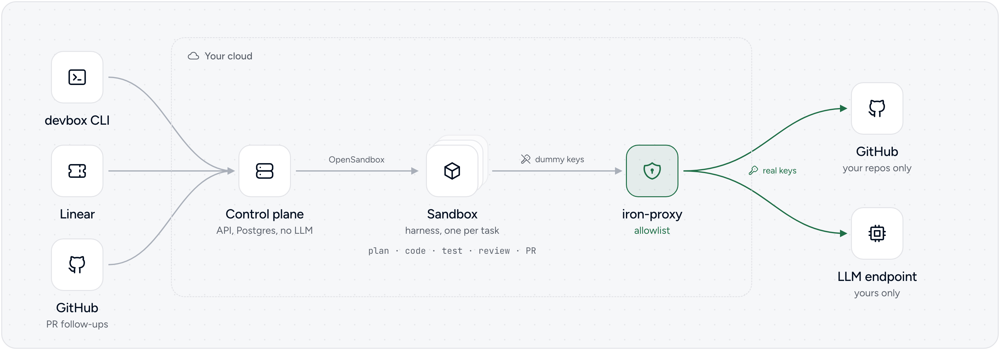
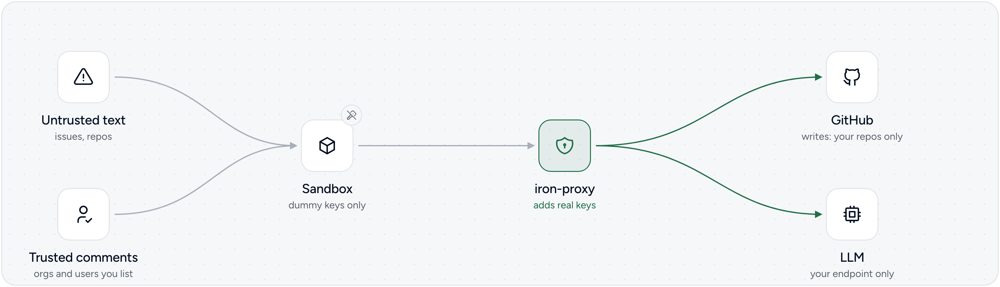
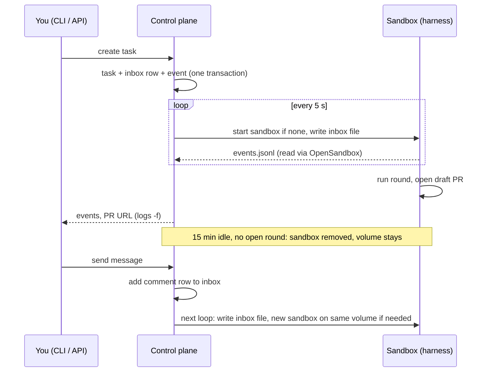
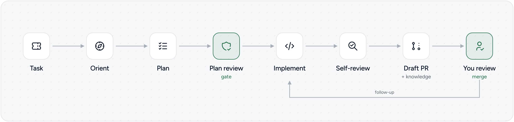

# Architecture

This page describes devbox as `bun run up` runs it: Docker Compose on one machine. [On Kubernetes](#on-kubernetes) covers what the Helm chart changes.

## Overview

A **control plane** stores tasks and starts one **sandbox** per task. The **harness** in the sandbox takes the task from plan to draft pull request. **iron-proxy** carries the sandbox's GitHub and LLM traffic and holds the real keys, so the sandbox only has dummy tokens.

<picture>
  <source media="(prefers-color-scheme: dark)" srcset="images/architecture-dark.png">
  
</picture>

## Components

| Component | Code | What it does |
|---|---|---|
| CLI | `cli/` | Client of the control plane's `/api/*`. Keeps no state but its config. |
| Control plane | `control-plane/` | Bun server. Stores tasks, starts and stops sandboxes, delivers work, reads progress. |
| OpenSandbox server | image `opensandbox/server` | Creates sandbox containers and gives the control plane access to their files. |
| Sandbox | `harness/` (the image `devbox-dev:local`) | One container per task. Runs the harness daemon. |
| iron-proxy | image `ironsh/iron-proxy` | Sandboxes' route to GitHub and the LLM. Allowlist, swaps dummy tokens for real ones. |
| Postgres | image `postgres:18` | The control plane's database. |

`control-plane/docker-compose.yml` defines the services. OpenSandbox creates the sandboxes.

### Networks

<picture>
  <source media="(prefers-color-scheme: dark)" srcset="images/security-dark.png">
  
</picture>

- **Compose default network:** control plane and Postgres.
- **`devbox` network:** sandboxes, iron-proxy and the OpenSandbox server. iron-proxy has aliases for the GitHub and LLM hosts, so sandbox traffic to them lands there. The sandbox trusts iron-proxy's local CA, which lets it swap in the real tokens.
- The control plane is not on that network. Its own GitHub calls go straight out.

### Workspace volumes

`bun run up` clones the configured repos into the `devbox-repos` volume. A task's first sandbox gets a copy of it, mounted at `/workspace`. The copy outlives the sandbox, so a later sandbox for the same task finds the repos, branches and harness state as they were.

## A task's life



- The loop runs at most the [sandbox concurrency limit](configuration.md#sandbox) of sandboxes.
- A `completed` event ends a round. The control plane records pull request URLs from events.
- `bun run devbox restart` removes the sandbox, fails open follow-up rounds, queues the assignment again and starts on a new volume.
- If a sandbox dies, the control plane starts a new one on the same volume, up to `MAX_TASK_RETRIES` times (3 by default), then fails the task.

## The inbox

The inbox is how the control plane gives the harness work.

- Each round of work is a row in the Postgres `inbox` table. Its status goes `pending`, `delivered` (written to the sandbox), `responded` (harness finished), or `failed` (could not be delivered).
- To deliver a row, the control plane writes `/workspace/.harness/inbox/<id>.json` in the sandbox and marks it `delivered`. If the write fails, the row stays `pending` and is retried.
- The file is the `InboxMessage` type in `control-plane/src/types/inboxMessage.ts`:

  ```json
  {
    "id": "<uuidv7>",
    "source": "api",
    "kind": "assignment",
    "external_id": "DBX-API-1",
    "payload": { "task_id": "…", "task_key": "DBX-API-1", "title": "…", "description": null, "external_url": "…", "target_id": "…" }
  }
  ```

- `kind` selects the harness's handler. Through the API: `assignment` (new task) and `comment` (follow-up). Other kinds in the type come from task sources not documented here.
- The daemon (`harness/src/harness/daemon.py`) polls `.harness/inbox/` every second and handles files in name order, which is creation order (UUIDv7). Done files move to `.processed/`, failed ones to `.error/`.
- A file lock, `.harness/inbox.lock`, keeps a second daemon from running.

## The event log

The event log is how the harness reports back.

- The harness appends one JSON object per line to `.harness/events.jsonl`, with a `seq`, a timestamp `ts`, a `type` and the `inbox_id` of its round. The types are in `control-plane/src/types/harnessEvent.ts`.
- `agent_thought`, `agent_action`, `agent_response` and `agent_error` carry a text `body`. `agent_response` is the round's answer.
- `pr_opened` carries the repo, pull request URL, branch and commit.
- `completed` ends a round. For an assignment, `status` is `completed`, `partial_failure` (some repos failed), `no_action` (no repo needs a change) or `failed`.
- The control plane keeps the last `seq` it read per task. Each loop it reads the file through OpenSandbox, handles newer events and skips unparsable lines.
- For API tasks, it stores these events, plus its own (`task_created`, `message_queued`, `task_restarted`, `sandbox_started`, `round_failed`), in `task_events`, and the API serves them from there. Linear tasks' events are not stored (the API reports `logging: "unavailable"`).

## The harness's stages

<picture>
  <source media="(prefers-color-scheme: dark)" srcset="images/lifecycle-dark.png">
  
</picture>

An `assignment` runs these stages (`harness/src/harness/handlers/assignment.py`):

| Stage | What happens |
|---|---|
| Setup | Prepares the workspace, fetches the latest commits of every repo (can be turned off). |
| Orientation | One agent picks the repos and components the task touches. |
| Planning | One agent per repo drafts that repo's part of the plan, in parallel. |
| Plan review | An adversarial agent checks the plan. If it does not approve, planners revise once, and a repo it says is missing gets a planner. Final plan: `.harness/plan.json` and `.harness/plan.md`. No repo to change: round ends `no_action`. |
| Implementation | One agent per planned repo makes the change (`.harness/implementation.json`). |
| Review | Review agents check the diff and a fix agent fixes or declines each finding, up to `HARNESS_REVIEW_MAX_ITERATIONS` passes (`.harness/review.json`). Off with `HARNESS_REVIEW_ENABLED`. |
| Distillation | Turns the agents' notes into knowledge files in the repo's knowledge directory (`.agents/knowledge/` by default). Off with `HARNESS_DISTILLATION_ENABLED`. |
| Commit | Per changed repo: branch, commit, push, draft pull request. |

Orientation, planning and plan review run in `run_planning` (`harness/src/harness/planning.py`) and are saved as one artifact, the plan. A `comment` round (`harness/src/harness/handlers/comment.py`) runs one agent with the task's earlier context and can push new commits to the pull request's branch.

Every stage except setup and commit calls a model, and each can have its own model and reasoning effort ([`llm.stages`](configuration.md#llm)). If the daemon restarts mid-assignment, it reuses saved stage results and continues.

## Task states

The API reports a task's `state`, computed from its inbox rows (`STATE_SQL` in `control-plane/src/repositories/apiTask.repository.ts`):

| State | When |
|---|---|
| `queued` | A round is `pending` or `delivered`, and the task has no sandbox yet. |
| `running` | A round is `pending` or `delivered`, and the task has a sandbox. |
| `failed` | No round is open, and the latest round failed: it was not delivered, or it completed with status `failed`. |
| `idle` | No round is open, and the latest round did not fail. |

"The latest round" is the inbox row updated last. `bun run devbox wait` and the `--wait` option return when the task is `idle` or `failed`.

## On Kubernetes

The chart `deploy/helm/devbox` runs the same components in two namespaces ([docs/kubernetes/README.md](kubernetes/README.md) installs it):

```
namespace: devbox (release)                       namespace: devbox-sandboxes
┌─────────────────────────────────────┐          ┌───────────────────────────────────┐
│ control plane (Deployment)          │─kubectl─▶│ task PVCs  ◀── restored from ───┐ │
│   ├─▶ Postgres (bundled or external)│          │ VolumeSnapshots repos-<ts>      │ │
│   └─▶ OpenSandbox server ──creates──────────▶  │ sandbox pods (harness image)    │ │
│ OpenSandbox controller              │          │   DNS → iron-proxy ClusterIP    │ │
│ iron-proxy (pinned ClusterIP)  ◀────────────── │   CA cert ConfigMap mounted     │ │
│   holds GitHub / LLM secrets        │ sandbox  │ snapshot builder CronJob ───────┘ │
│   ──▶ internet (allowlisted)        │  egress  │   (clone-only, real token)        │
│ bootstrap Job (generated secrets)   │          │                                   │
└─────────────────────────────────────┘          └───────────────────────────────────┘
```

What differs from the local stack:

- **Sandboxes are pods.** The OpenSandbox server creates each one in `devbox-sandboxes` from a pod template in its config (the ConfigMap `devbox-sandbox-template`). The template sets the DNS server, mounts the iron-proxy CA and gives the pod no service account token.
- **Workspaces are volumes restored from snapshots.** The snapshot builder, a CronJob, clones the configured repos into a scratch volume and takes a VolumeSnapshot `repos-<timestamp>`; it keeps the newest 3. For a task, the control plane creates a PersistentVolumeClaim from the newest ready snapshot and mounts it at `/workspace`. It replaces the `devbox-repos` volume.
- **DNS replaces network aliases.** iron-proxy's Service has a fixed address, `ironProxy.clusterIP`, and sandboxes use it as their only DNS server. iron-proxy answers every name with its own address, so all sandbox traffic reaches it, and it refuses hosts that are not on the allowlist.
- **Secrets are mounted files.** iron-proxy reads the GitHub token and the LLM key from Secrets mounted as files, and the control plane reads the GitHub token the same way (it gets only a dummy LLM key). Both re-read them, so a rotated Secret takes effect without a restart ([docs/kubernetes/secrets.md](kubernetes/secrets.md)).

### Traffic rules

The chart ships these NetworkPolicies, always on. They need a CNI that enforces NetworkPolicy.

- **Sandboxes:** egress only to iron-proxy, on DNS (53, UDP and TCP), 80 and 443; ingress only from the OpenSandbox server. No service account token.
- **iron-proxy:** ingress only from sandboxes.
- **OpenSandbox server:** ingress only from the control plane. Its `/sandboxes/{id}/proxy/{port}` endpoint skips the API key, so anything that reaches the server can run commands in any sandbox.
- **Postgres:** ingress only from the control plane.
- **Snapshot builder:** egress to DNS, the Kubernetes API and port 443. A plain NetworkPolicy cannot restrict by host name, so this is not limited to GitHub; the builder only clones and runs no repo code.
- **Control plane:** a ClusterIP Service. Two optional Ingresses: `webhooks` for `/webhook/`, `api` for everything.

## Reference

| What | Value |
|---|---|
| Create a task | `POST /api/tasks` (`bun run devbox create`) |
| Send a message | `POST /api/tasks/<ref>/messages` (`bun run devbox send`) |
| Restart a task | `POST /api/tasks/<ref>/restart` (`bun run devbox restart`) |
| Stream events | `GET /api/tasks/<ref>/events/stream` (`bun run devbox logs -f`) |
| Task volume label | `devbox.task-volume`; cleanup filters on it |
| Plan review verdict | `.harness/plan-review.json`, kept for debugging; nothing reads it back |
